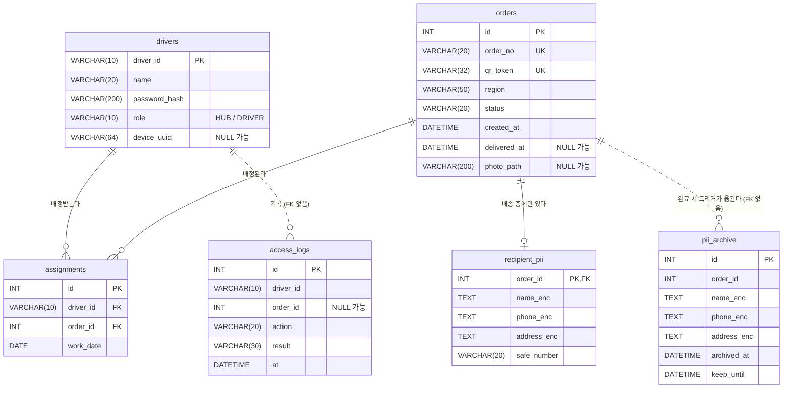

# db/ — DB 구조와 가상 데이터

| 파일 | 내용 |
|---|---|
| `schema.sql` | 시연용 MySQL 8 스키마 (테이블 6개 + 배송 완료 트리거). 이름은 `server/SERVER_SPEC.md` §4 약속 그대로 |
| `demo_data.json` | 시드용 가상 데이터 (기사 4명, 주문 8건). 서버가 `DEMO_DATA=../db/demo_data.json`으로 읽는다 |

## 구조



- **개인정보는 `orders`에 없다.** 조회용은 `recipient_pii`, 보존용은 `pii_archive`에 암호문(AES-256-GCM)으로만 둔다.
- **배송 완료 트리거 `trg_orders_delivered`**: `orders.status`가 `DELIVERED`로 바뀌는 순간 `recipient_pii` 행을 `pii_archive`로 옮기고(`keep_until` = 지금 + 5년) 지운다. `safe_number`는 보존하지 않는다.
- 시각은 모두 KST 기준 값이다. 트리거도 DB 서버 시간대와 상관없이 UTC + 9시간으로 만든다.

## 적용

```powershell
mysql -u root -p < db/schema.sql        # seungcurity DB와 테이블·트리거 생성 (다시 돌리면 테이블을 지우고 새로 만든다)
cd server
# .env 의 DATABASE_URL=mysql+pymysql://user:pw@localhost:3306/seungcurity?charset=utf8mb4
python -m app.seed                      # demo_data.json 으로 채운다 (배정은 오늘 날짜)
```

MySQL 8.0.16 이상이 필요하다(CHECK 제약).
